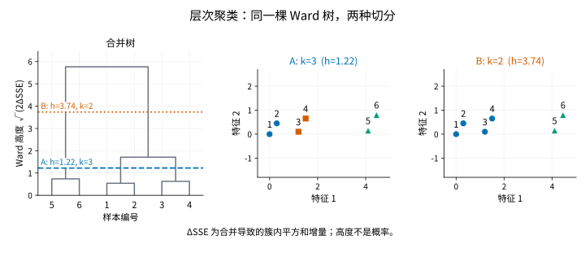

# AgglomerativeClustering

> 语言：中文
> 最后更新：2026-10-14
> 切换：[English](../../en/unsupervised/agglomerative-clustering.md)

## 概览

比较产品画像或实验样本时，你可能既想知道哪些观测最相近，也想知道这些小组如何归入更大的类别。一次平面划分只回答了其中一个层级的问题。

`AgglomerativeClustering` 从下向上构建嵌套分组。开始时每条观测独自成组，随后反复合并最接近的两组，直到只剩一个组。合并树记录了局部相似关系如何逐步组成更大的群组。在某个层级切分这棵树，就得到一个平面划分，同时保留此前各次合并的上下文。合并一旦发生就不会撤销：切分越粗，已有的小组只会继续归入更大的组，组内成员不会被拆开重新分配。

<a id="估计方程"></a>
## 构建与切分层次树

下图的编号点和树描述的是同样六个观测。沿树枝向上看，可以看到小组怎样合成更大的组。切分 A 得到 `(1, 2)`、`(3, 4)`、`(5, 6)` 三组，较高的切分 B 将前两组合并；两幅散点图表示这两种切分。

图中的 `h` 是水平切线的高度，`k` 是切分后留下的组数：数一数切线穿过多少条尚未汇合的树枝，就能得到组数。A 处的 `h=1.22` 留下 `k=3` 组；B 处的 `h=3.74` 允许再合并一次，留下 `k=2` 组。切线每跨过一个新的合并位置，组数就会减少，分组也会变粗。

Ward 是这棵树采用的合并规则：优先选择使各组成员相对组均值的分散程度增加最少的合并。纵轴用来表示这种合并代价，连接位置越高，代表这次合并的代价越大。后面的连接准则一节会定义这个代价，并解释轴上标注的平方根尺度。现在读分组时，可以从每个编号沿树枝向上走到切线；在切线下已经汇合的编号属于同一组。叶子之间的横向间隔不表示观测间距离，树的高度也不是概率或显著性水平。



接下来的问题是：怎样判断下一步应合并哪两组？这需要选择衡量组间接近程度的连接准则；同样的点采用不同准则，可能得到不同的树。

<a id="目标函数--损失函数"></a>
## 链接准则与合并规则

层次聚类是贪心合并过程，不是全局光滑优化问题。每一步都合并连接准则（linkage criterion）取值最小的一对簇。以下公式中，$A$、$B$ 是候选合并组，$|A|$、$|B|$ 是各自样本数，$\bar{x}_A$、$\bar{x}_B$ 是各组均值向量。前三种准则以不同方式概括跨组距离；Ward 衡量的是用一个合并后的均值代替两个独立均值所付出的代价。

单连接（`linkage="single"`）查看两组中最近的一对成员，因此少数桥接点就可能把原本分开的组串起来：

$$
d(A, B)
=
\min_{x \in A,\; y \in B}
\left\|x - y\right\|_2 .
$$

完全连接（`linkage="complete"`）查看两组中最远的一对成员；只有所有跨组距离都较小，两组才算接近：

$$
d(A, B)
=
\max_{x \in A,\; y \in B}
\left\|x - y\right\|_2 .
$$

平均连接（`linkage="average"`）对所有跨组距离取平均：

$$
d(A, B)
=
\frac{1}{|A||B|}
\sum_{x \in A}\sum_{y \in B}
\left\|x - y\right\|_2 .
$$

Ward 连接每一步合并使簇内平方误差增量最小的一对簇：

$$
\Delta(A, B)
=
\frac{|A||B|}{|A|+|B|}
\left\|\bar{x}_A-\bar{x}_B\right\|_2^2 .
$$

上面的六点图使用 Ward 连接。树由拟合结果 `children_` 和 `distances_` 绘制；Ward 高度为 $\sqrt{2\Delta}$，其中 $\Delta$ 是上式定义的簇内平方误差增量，图中轴标签的 ΔSSE 表示同一个增量。这些连接准则的定义也可参见 [SciPy 连接准则参考](https://docs.scipy.org/doc/scipy/reference/generated/scipy.cluster.hierarchy.linkage.html)。

## 何时使用

如果结果中真正重要的是逐层合并结构，而不只是每条记录的最终标签，可使用层次聚类。

为不同簇数分别运行 KMeans，并不保证各次划分彼此嵌套。Ward 与 [KMeans](kmeans.md) 都使用平方误差的思想，但解决的问题不同：Ward 逐次合并，先前的合并无法撤销；KMeans 则可以把单条记录重新分给其他中心。如果主要需要可复用的中心以及未来记录的分配规则，可选择 KMeans；如果希望观察不同分组层级之间的关系，层次树更切题。如果更关心让稀疏观测留在簇外，而不是构建覆盖所有样本的树，可考虑 [DBSCAN](dbscan.md)。

即使数据没有截然分开的天然类别，也能构建一棵树。特征缩放和连接准则都会改变它，较大的合并高度也不是显著性检验。应检查各分支是否具有实际解释；这里的“精确”指遵循所选连接过程，不表示找到了唯一正确的分类体系或全局最优划分。

## 导入路径

```python
from statgpu.unsupervised import AgglomerativeClustering
```

## 参数

- `n_clusters`：切树后的簇数。
- `linkage`：`"single"`、`"complete"`、`"average"` 或 `"ward"`。
- `metric`：仅支持 `"euclidean"`。
- `device`：`"cpu"`、`"cuda"`、`"torch"` 或 `"auto"`。该估计器的 `device="auto"` 仍默认选择 CPU；显式请求 GPU 时会执行稠密、精确的后端实现。

## 一个可独立运行的 CPU 示例

<!-- learner-example: agglomerative-clustering -->
```python
import numpy as np
from statgpu.unsupervised import AgglomerativeClustering

rng = np.random.default_rng(0)
X = np.vstack([rng.normal(-2, 0.3, (15, 2)), rng.normal(2, 0.3, (15, 2))])
model = AgglomerativeClustering(n_clusters=2, linkage="ward", device="cpu")
labels = model.fit_predict(X)
print(labels.shape, model.children_.shape, model.distances_[-3:])
```

30 个样本对应 `(29, 2)` 的合并对。除了最终分组，还应查看合并高度；CPU 的 maxclust 切分在高度相同时可能得到少于请求数量的簇。不提供新样本预测。

安装了相应 GPU 后端后，可新建估计器并指定 `device="cuda"`（CuPy）或 `device="torch"`（Torch CUDA）。标签、合并对与合并高度始终返回 NumPy 数组，即使在 GPU 上拟合也如此；输出及主机端步骤见 [API 参考](api-reference.md#agglomerativeclustering)。显式请求的 GPU 不可用时会报错。

## 近似与解释边界

`AgglomerativeClustering` 不提供标准误或显著性检验。对稠密欧氏输入，CPU、CuPy 与 Torch 路径都给出精确计算，均支持 `"single"`、`"complete"`、`"average"` 和 `"ward"` 四种连接准则。GPU 路径面向中小规模数据，不会静默回退到 CPU。GPU 执行会分配稠密距离矩阵；一旦超过配置的距离矩阵内存上限，会明确抛出 `MemoryError`。

GPU 路径通过展开平方范数计算成对距离。很大的共同特征偏移可能导致消减误差并改变层次结构；应在拟合前以 float64 减去由训练数据确定的偏移，这不会改变原本的欧氏几何关系。SciPy 的 CPU 层次聚类路径不使用这一共享 GPU 距离公式。

`distances_` 中的 Ward 合并高度为 $\sqrt{2\Delta(A,B)}$，不是平方误差增加量 $\Delta(A,B)$ 本身。GPU 距离矩阵估计内存会与配置上限比较；默认上限为 1 GiB，可在导入模块前设置 `STATGPU_AGGLOMERATIVE_GPU_MAX_BYTES`。该值不是当前可用显存。

## 计算路径与树的保存

- 从每个样本一个簇开始。
- 反复合并所选连接准则取值最小的两个簇。
- 将合并树保存为 `children_`，将合并距离保存为 `distances_`。
- 按 `n_clusters` 切树并生成 `labels_`。

CPU 路径调用 SciPy 的层次聚类子模块计算精确连接；显式 CuPy/Torch 路径在所选 GPU 后端上使用稠密距离矩阵。单连接先构建最小生成树，再在 CPU 上组装合并树；完全连接、平均连接和 Ward 连接则使用 Lance–Williams 公式更新连接距离。

## 输出字段

- `labels_`
- `children_`
- `distances_`
- `n_features_in_`

## FAQ

**什么时候适合用 GPU 路径？**
中小规模的稠密数据可以显式使用 `device="cuda"` 或 `device="torch"`。层次聚类仍是顺序贪心过程且需要稠密距离矩阵；大数据可能更适合 CPU 路径或其他聚类方法。

**能对新样本 predict 吗？**
不能。当前实现不支持对未见样本调用 `predict`。


## 完整 API 参考

构造默认值、全部公开方法、输出形状与限制见 [AgglomerativeClustering API 参考](api-reference.md#agglomerativeclustering)。

<a id="references"></a>

## 参考文献

- Sneath, P. H. A. (1957). The application of computers to taxonomy. *Journal of General Microbiology*, 17(1), 201-226. https://doi.org/10.1099/00221287-17-1-201
- Murtagh, F. (1983). A survey of recent advances in hierarchical clustering algorithms. *The Computer Journal*, 26(4), 354-359. https://doi.org/10.1093/comjnl/26.4.354
- Muellner, D. (2013). fastcluster: Fast hierarchical, agglomerative clustering routines for R and Python. *Journal of Statistical Software*, 53(9), 1-18. https://doi.org/10.18637/jss.v053.i09
- SciPy Developers. `scipy.cluster.hierarchy`: Hierarchical clustering. SciPy documentation. https://docs.scipy.org/doc/scipy/reference/cluster.hierarchy.html
