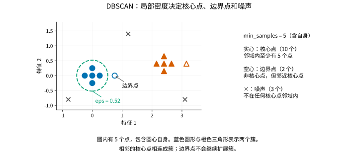

# DBSCAN

> 语言：中文
> 最后更新：2026-10-14
> 切换：[English](../../en/unsupervised/dbscan.md)

## 概览

设想一个点云中有两条采样密集的弯曲带，中间还散落着一些零星观测。你希望找回这两条带，不预先规定簇数，也不强迫零星点归入某组。按最近中心分组可能切开一条弯曲带，并把孤立点吸收到某个簇中，因为这种划分要求每条记录都有所属中心。

`DBSCAN` 转而寻找周围有足够观测的局部邻域，再把相邻的密集邻域连成簇，吸纳紧邻簇的边界点，其余点则不分组。组织数据的依据因此变成了局部密度连通性，而不是到某一个代表性中心的距离。[DBSCAN 原始论文](https://aaai.org/papers/kdd96-037-a-density-based-algorithm-for-discovering-clusters-in-large-spatial-databases-with-noise/)正是针对带噪声、不规则形状的聚类问题提出这一思路。

## 何时使用

当密集区域可能形状不规则，且允许部分样本不归入任何簇时，可使用 DBSCAN。与 [KMeans](kmeans.md) 不同，它不要求给定目标簇数。但你仍需选择邻域尺度和最小局部计数，因此发现多少组取决于这些选择，并不是无须调参就能找出“真实”簇数。

`eps` 与特征单位一致；确定有意义的特征尺度后，应比较多个半径和 `min_samples` 设置。半径太小可能把一个组切碎，或让大量观测不被分组；半径太大则可能连通本想分开的组。若不同簇的密度差异很大，一个统一半径可能并不合适，可参见[密度聚类指南](https://scikit-learn.org/stable/modules/clustering.html#dbscan)。

噪声标签只表示该观测在所选设置下不属于一个密集区域，不能据此认定它是测量错误、欺诈或其他实质性异常。如果主要需求是把未来记录分配给稳定中心，可考虑 KMeans；这里的 DBSCAN 描述的是已拟合数据集，不提供新数据预测规则。

## 导入路径

```python
from statgpu.unsupervised import DBSCAN
```

<a id="目标函数--损失函数"></a>
## 密度判定与成簇规则

DBSCAN 不是光滑优化问题，没有可微的损失函数；它的准则是密度可达性（density reachability）：

- 如果一个点的闭 `eps` 邻域内至少包含 `min_samples` 个点（包括该点自身），该点就是核心点（core point）。
  $$
  \left|\left\{x_j : \left\|x_i - x_j\right\|_2 \le \varepsilon\right\}\right|
  \ge \text{min\_samples}.
  $$
- 由 `eps` 邻接关系连通的核心点构成一个簇。
- 能从核心点集到达、但自身不是核心点的点称为边界点（border point）。
- 其余点是噪声（noise），标签为 `-1`。

公式中，$\varepsilon$ 对应 `eps`，$x_i$ 是正在检查的点，集合包含半径内的所有观测。边界点可以加入一个簇，但不会继续扩展它：仅由非核心点组成的稀疏链，不能把两个核心点连通分量接起来；足够密集的核心点桥接仍可能让它们合并。因此，局部计数要求使 DBSCAN 区别于简单地把所有邻近点连在一起。



虚线圆是半径 `eps=0.52` 的邻域，包含圆心自身在内的五个观测，因此圆心满足 `min_samples=5` 的核心点条件。实心符号表示核心点；空心符号自身不是核心点，但因邻近核心点而加入相应簇。灰色叉号得到噪声标签 `-1`，颜色和形状区分两个簇。边界点不会继续扩展簇，改变半径或特征尺度可能改变这些分配；图中的噪声标记也不能证明观测有误。

## 一个可独立运行的 CPU 示例

<!-- learner-example: dbscan -->
```python
import numpy as np
from statgpu.unsupervised import DBSCAN

rng = np.random.default_rng(0)
X = np.vstack([rng.normal(-2, 0.1, (20, 2)), rng.normal(2, 0.1, (20, 2)), [[8., 8.]]])
model = DBSCAN(eps=0.5, min_samples=3, device="cpu")
labels = model.fit_predict(X)
print(labels.shape, np.unique(labels), model.core_sample_indices_.shape)
```

最后一行远离其他样本，标签为表示噪声的 `-1`。`components_` 保存核心样本，不是聚类中心。实现不提供新数据预测规则；把新旧数据一起重新拟合可能改变原有标签。

安装了相应 GPU 后端后，可新建估计器并指定 `device="cuda"`（CuPy）或 `device="torch"`（Torch CUDA）。数组通常留在该后端；输出所在设备及主机端步骤见 [API 参考](api-reference.md#dbscan)。显式请求的 GPU 不可用时会报错。

**在 GPU 上拟合前**，请先阅读[计算路径与内存](#计算路径与内存)，了解 float32 精度、大特征偏移、主机传输和近邻图内存限制。

## 参数

- `eps`：邻域半径，必须为正且有限。非有限值当前不一定被拒绝，因此应在拟合前自行验证。
- `min_samples`：成为核心点所需的闭邻域样本数。
- `metric`：仅支持 `"euclidean"`。
- `batch_size`：可选的 GPU 距离计算批量大小，不限制全部图边的存储。
- `device`：`"auto"`、`"cpu"`、`"cuda"` 或 `"torch"`。

## 计算路径与内存

DBSCAN 支持 CPU、CuPy/CUDA 与 Torch CUDA。计算和内存成本取决于密度、维数及是否安装编译扩展，GPU 路径包含主机传输。

CPU 数据不超过 12 个特征时使用 SciPy 树搜索；更高维数据使用 scikit-learn 的 `NearestNeighbors`，需安装 scikit-learn。编译好的 statgpu Cython 扩展可加速图标签计算，未编译时使用 Python 实现。

GPU 距离计算使用 float32，保存的核心样本使用 float64。两条 GPU 路径都包含主机传输，CuPy 路径还有部分图处理在 Python 中完成。测量完整拟合耗时时，应把这些成本计入。`batch_size` 只限制距离计算的批次，不限制整个近邻图；密集邻域仍可能占用二次增长的内存。`eps` 边界附近的 float32 比较可能不同，应检查标签和噪声判定的稳定性。

很大的共同特征偏移还可能在 GPU 转为 float32 或展开计算距离时丢失样本间距，即使这些距离并不接近 `eps` 边界。应在数据仍为 float64 时，先减去由训练数据确定的统一特征偏移，再拟合；平移保持欧氏距离不变，无需改变 `eps`。应保存该偏移，以便把 `components_` 转回原始单位。标签有限并不代表近邻图正确。

## 近似与解释边界

算法目标由欧氏邻域决定，不涉及统计推断。当前未编译扩展的 CPU 路径存在一个限制：当核心点之间没有任何连边时，可能错误地把互不连通的核心点合并。遇到这类稀疏核心点配置时，应先与独立实现核对标签；稠密簇示例不能覆盖这个情况。

## 输出字段

- `labels_`
- `core_sample_indices_`
- `components_`
- `n_features_in_`

## FAQ

**能为新样本预测簇吗？**
不能。只提供训练数据的 `fit_predict`；`predict` 会抛出 `NotImplementedError`。

**GPU 一定更快吗？**
速度取决于数据量、密度、传输和可用内存。应测量完整工作流，支持 GPU 本身不代表加速保证。


## 完整 API 参考

构造默认值、全部公开方法、输出形状与限制见 [DBSCAN API 参考](api-reference.md#dbscan)。

<a id="references"></a>

## 参考文献

- Ester, M., Kriegel, H.-P., Sander, J., & Xu, X. (1996). A density-based algorithm for discovering clusters in large spatial databases with noise. In *Proceedings of the Second International Conference on Knowledge Discovery and Data Mining (KDD-96)* (pp. 226-231). AAAI Press. https://aaai.org/papers/kdd96-037-a-density-based-algorithm-for-discovering-clusters-in-large-spatial-databases-with-noise/
- Schubert, E., Sander, J., Ester, M., Kriegel, H.-P., & Xu, X. (2017). DBSCAN revisited, revisited: Why and how you should (still) use DBSCAN. *ACM Transactions on Database Systems*, 42(3), Article 19. https://doi.org/10.1145/3068335
