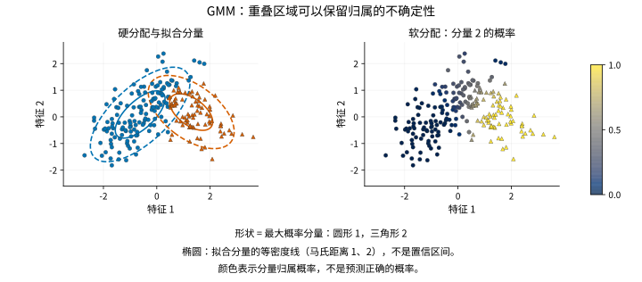

# GaussianMixture

> 语言：中文
> 最后更新：2026-10-14
> 切换：[English](../../en/unsupervised/gaussian-mixture.md)

## 概览

`GaussianMixture` 将多个高斯分布组合起来，描述数值观测的分布。每个成分有自己的中心和协方差结构，后者控制分散程度与相关性；混合权重决定各成分在总密度中的占比。拟合后既可计算新观测处的密度，也可表达它属于各成分的不确定性。

对每条记录，`predict_proba` 给出它属于各个拟合成分的概率，例如成分 A 为 0.7、成分 B 为 0.3；同一条记录的这些概率相加为 1。这些数称为责任度，也就是这里说的“软归属”。它们以拟合模型为前提，不能当作现实类别判断正确的概率。

例如，几种运行状态的测量值可能重叠，波动方向也可能不同。只用一个高斯分布，可能把这些差异抹平；按最近中心给出硬标签，又会把每条记录确定地分给一个组，掩盖边界处的模糊性。混合模型能保留这种不确定性，但不能证明各成分就是实际运行状态。

期望最大化（EM）算法交替计算这些概率，再将它们作为权重更新各成分分布。因此，模型既能描述数据密度，也能给出基于模型的软分组；概率表述可参见[高斯混合模型指南](https://scikit-learn.org/stable/modules/mixture.html)。

## 何时使用

当组间重叠本身值得关注，或需要计算拟合模型在新观测处给出多大密度时，可使用混合模型。与 [KMeans](kmeans.md) 相比，协方差建模让成分的分散程度参与决定归属，而不只依据到中心的欧氏距离。可表达的形状取决于所选协方差结构；每个成分的样本不多时，简单结构可以作为起点。

应区分“描述密度”和“给群体命名”这两个目标。多个高斯成分可能只是在近似同一个非高斯总体，因此拟合出的一个成分不一定对应真实人群或类别。成分更多、协方差更灵活，不意味着解释更有意义。应检查责任度、收敛状态及留出数据的对数密度，并在相同记录和相同预处理下比较候选模型。

软归属也不等于噪声检测。即使一条读数远离所有成分，它仍可能对其中“相对没那么不可能”的成分具有很高的责任度，因此应同时查看密度与归属。如果希望把簇定义为密度连通区域，并让背景点不被分组，可考虑 [DBSCAN](dbscan.md)。两种方法的输出都不能单独说明一条异常观测背后的实际原因。

## 导入路径

```python
from statgpu.unsupervised import GaussianMixture
```

## 目标函数 / 损失函数

由于不知道每条观测由哪个成分生成，需要将所有成分的加权贡献相加，得到它的密度。在给定混合成分数 `K` 时，模型最大化这一混合密度的平均对数，也就是平均对数似然：

$$
\ell(\theta)
=
\frac{1}{n}\sum_{i=1}^{n}
\log\left[
\sum_{k=1}^{K}
\pi_k
\mathcal{N}\left(x_i \mid \mu_k, \Sigma_k\right)
\right].
$$

其中 $x_i$ 是第 $i$ 条观测，$n$ 是观测数，$K$ 是成分数。$\pi_k$ 是非负的
混合权重，满足 $\sum_k\pi_k=1$；$\mu_k$ 是该成分的均值向量，$\Sigma_k$
是其协方差，描述分布的离散程度及成分内的特征相关性。对数内部的加权和就是
$x_i$ 处的混合密度。

`covariance_type` 决定 `\Sigma_k` 的形状：每个成分一组对角协方差、每个成分一个球形方差、所有成分共享一个完整协方差，或每个成分各自拥有完整协方差。`reg_covar` 在对角和球形协方差的 M 步中充当方差下限；完整和共享协方差则在对角线上加上该值。不同结构采用的约定不同，相同数值也未必与其他库等价。



两图使用同一个 `covariance_type="full"` 的双成分拟合模型。点的形状表示责任度较大的成分，右图颜色表示 `predict_proba` 给出的成分 2 归属概率；中间色保留了硬标签掩盖的模糊性。椭圆上的点到各自拟合均值的马氏距离为 1 或 2，表示成分的等密度线，不是置信区间。这些概率以拟合模型为条件，并不是正确识别现实类别的概率。

## 一个可独立运行的 CPU 示例

<!-- learner-example: gaussian-mixture -->
```python
import numpy as np
from statgpu.unsupervised import GaussianMixture

rng = np.random.default_rng(0)
X = np.vstack([rng.normal(-2, 0.4, (40, 2)), rng.normal(2, 0.4, (40, 2))])
model = GaussianMixture(n_components=2, covariance_type="full", n_init=2, random_state=0, device="cpu")
model.fit(X)
proba = model.predict_proba(X)
print(proba.shape, model.converged_, model.score(X), model.bic(X))
```

责任度形状为 `(80, 2)`，每行和为 1。它表示当前拟合模型下的条件归属概率，不是置信水平。AIC/BIC 应在相同观测上比较，也不能弥补拟合失败。

安装了相应 GPU 后端后，可新建估计器并指定 `device="cuda"`（CuPy）或 `device="torch"`（Torch CUDA）。数组通常留在该后端；输出所在设备及主机端步骤见 [API 参考](api-reference.md#gaussianmixture)。显式请求的 GPU 不可用时会报错。

`lower_bound_` 保存最后一次参数更新前监测到的 E 步值；最终模型的平均对数密度应调用 `score(X)`。计算过程见[EM 更新公式](#进阶em-更新公式)。

## 参数

- `n_components`：混合成分数。
- `covariance_type`：`"diag"`、`"spherical"`、`"tied"` 或 `"full"`。
- `tol`、`reg_covar`、`max_iter`、`n_init`。
- `init_params`：`"kmeans"` 或 `"random"`。
- `random_state`。
- `device`：`"auto"`、`"cpu"`、`"cuda"` 或 `"torch"`。

## 近似与解释边界

`GaussianMixture` 提供似然分数，但不提供参数标准误或 p 值。EM 优化的似然是非凸的，可能收敛到局部最优；结果的可复现性取决于初始化、`random_state`、`n_init`、`tol` 和 `max_iter`。

## 输出字段

- `weights_`
- `means_`
- `covariances_`
- `precisions_cholesky_`
- `converged_`
- `n_iter_`
- `lower_bound_`
- `n_features_in_`

## FAQ

**应该选择哪种协方差类型？**
`"diag"` 分别估计各特征的方差，但不表示成分内的特征相关性。`"spherical"` 进一步要求每个成分内各特征方差相等，因此尤其依赖特征单位的选择。`"tied"` 在各成分间共享一个完整协方差；`"full"` 允许每个成分有不同的完整协方差，需要更多数据才能稳定估计。可用留出数据的对数密度，或在同一训练集上计算的 AIC/BIC 比较合理的结构，并检查拟合形状是否有实际意义。

**`score`、`score_samples`、`aic`、`bic` 分别是什么？**
`score_samples` 返回逐样本对数似然，`score` 返回平均对数似然，`aic`/`bic` 按对应协方差类型的参数量计算。


## 数值与使用注意事项

`reg_covar=0` 会取消协方差保护，只适用于初始化及后续更新的协方差始终正定的情况。全常量数据、对角模型中的常量特征或塌缩的混合成分都可能破坏这一条件。当前对角和球形路径可能从 `fit` 正常返回，但协方差、密度和责任概率为 NaN；完整和共享协方差路径则可能抛出线性代数错误。对此类数据应保留正的 `reg_covar`，并在使用结果前检查协方差、`score_samples(X)` 和 `predict_proba(X)` 是否全部有限。仅仅返回了估计器，并不代表拟合结果可用。

对角和球形协方差更新使用原始二阶矩，对角密度公式也会对较大的二次项相减。当偏移远大于簇内变化时，即使 `converged_` 为真，协方差和似然也可能错误。应先减去由训练数据确定的偏移，并在后续评分时复用；平移不会改变目标混合密度。增大 `reg_covar` 不能修复这种消减误差。

<a id="估计方程"></a>

## 进阶：EM 更新公式

实现采用对数域（log-domain）EM：

- 初始化：使用 KMeans 或随机样本初始化均值。
- E 步：计算加权的成分对数概率：

  $$
  a_{ik}
  =
  \log \pi_k
  +
  \log \mathcal{N}\left(x_i \mid \mu_k, \Sigma_k\right).
  $$

  用 log-sum-exp 归一化：

  $$
  \log p(x_i)
  =
  \operatorname{logsumexp}_{k=1}^{K}\left(a_{ik}\right).
  $$

  责任度（responsibility）为：

  $$
  r_{ik}
  =
  \frac{
    \pi_k \mathcal{N}\left(x_i \mid \mu_k, \Sigma_k\right)
  }{
    \sum_{\ell=1}^{K}
    \pi_\ell \mathcal{N}\left(x_i \mid \mu_\ell, \Sigma_\ell\right)
  }.
  $$

- M 步：更新有效样本数、权重、均值和协方差：

  $$
  n_k = \sum_{i=1}^{n} r_{ik},
  \qquad
  \pi_k = \frac{n_k}{n},
  \qquad
  \mu_k = \frac{1}{n_k}\sum_{i=1}^{n} r_{ik}x_i.
  $$

  完全协方差（full）：

  $$
  \Sigma_k
  =
  \frac{1}{n_k}\sum_{i=1}^{n}r_{ik}
  (x_i-\mu_k)(x_i-\mu_k)^\top
  +
  \text{reg\_covar}\,I.
  $$

  共享协方差（tied）：

  $$
  \Sigma
  =
  \frac{1}{n}\sum_{k=1}^{K}\sum_{i=1}^{n}r_{ik}
  (x_i-\mu_k)(x_i-\mu_k)^\top
  +
  \text{reg\_covar}\,I.
  $$

  对角（diagonal）和球形（spherical）协方差使用同一套责任度加权方差，分别取对角元素或特征平均：

  $$
  \sigma_{kj}^{2}
  =
  \max\left(
    \frac{1}{n_k}\sum_{i=1}^{n} r_{ik} x_{ij}^{2}
    -
    \mu_{kj}^{2},
    \text{reg\_covar}
  \right),
  \qquad
  \sigma_k^2 = \frac{1}{p}\sum_{j=1}^{p}\sigma_{kj}^{2}.
  $$

- 监控的下界（lower bound）为：

  $$
  \mathcal{L}
  =
  \frac{1}{n}\sum_{i=1}^{n}\log p(x_i).
  $$

  当相邻监测值的绝对差小于 `tol` 或达到 `max_iter` 时停止。`lower_bound_` 保存最后一次参数更新之前的 E 步值，最终模型的平均对数密度应调用 `score(X)`；`n_init` 会运行多组初始化，并保留下界最高的一组。

## 完整 API 参考

构造默认值、全部公开方法、输出形状与限制见 [GaussianMixture API 参考](api-reference.md#gaussianmixture)。

<a id="references"></a>

## 参考文献

- Dempster, A. P., Laird, N. M., & Rubin, D. B. (1977). Maximum likelihood from incomplete data via the EM algorithm. *Journal of the Royal Statistical Society: Series B (Methodological)*, 39(1), 1-22. https://doi.org/10.1111/j.2517-6161.1977.tb01600.x
- McLachlan, G. J., & Peel, D. (2000). *Finite Mixture Models*. Wiley Series in Probability and Statistics. Wiley.
