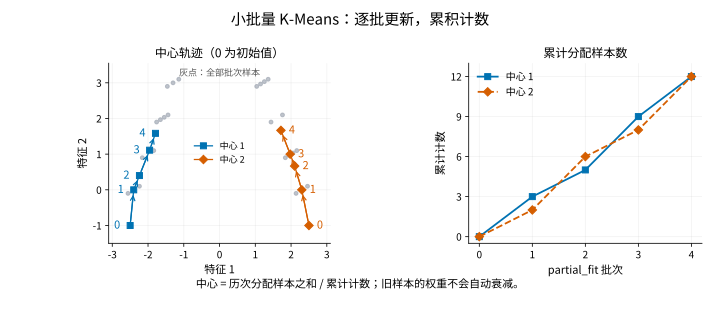

# MiniBatchKMeans

> 语言：中文
> 最后更新：2026-10-14
> 切换：[English](../../en/unsupervised/minibatch-kmeans.md)
> 路径：`statgpu.unsupervised.MiniBatchKMeans`

## 概览

你可能希望用少量典型画像概括数百万条观测，或在记录分批到达时持续更新这些画像。普通 KMeans 更新中心时会重新遍历全部记录。只抽取一个小样本拟合，虽然减少了这部分工作，却让后续记录无法参与画像的形成。

`MiniBatchKMeans` 让后续批次继续更新同一组中心：先用当前中心给这一批记录分组，再把各组的批内均值与累积的分配结果合并。它改变的是中心的学习方式，而不是“好中心”的标准，目标仍是平方欧氏重构误差。[小批量算法说明](https://scikit-learn.org/stable/modules/generated/sklearn.cluster.MiniBatchKMeans.html)介绍了这一方法的一般背景；statgpu 使用的全数据步骤见下文。

## 何时使用

当分批、增量地更新中心更适合你的工作流程，且可以接受近似解时，可使用它。如果完整数据上的迭代成本可以接受，普通 [KMeans](kmeans.md) 仍是有用的比较对象。小批量更新不会解决 KMeans 的几何限制，也不会引入噪声标签或归属概率。

statgpu 中有两种不同用法。`fit` 仍接收完整稠密数据，并在最后执行全数据修正，因此仅把批量大小调小，并不能让这次调用处理无法整体装入内存的数据。外部数据流应分块调用 `partial_fit`。不同批次的特征含义、缩放和中心化方式必须一致；采用基于数据的初始化时，首批记录数须足以初始化所有中心。

批次组成也很重要。若首批只包含一种运行状态，就难以为整个总体提供良好的初始画像。条件允许时，应混合或打乱具有代表性的记录，并在同一评估集上检查最终中心。累积更新会保留旧观测的影响，没有遗忘机制，因此它不会自动变成一个只描述近期行为的模型。

## 导入路径

从 `statgpu.unsupervised` 导入：

```python
from statgpu.unsupervised import MiniBatchKMeans
```

## 目标函数

目标仍是 KMeans 的惯性：

$$
\sum_i \min_j \|x_i - c_j\|_2^2.
$$

其中 $x_i$ 是一条观测，$c_j$ 是一个中心；取最小值表示为该记录选择最近的中心。小批量更新用当前批次的分配近似优化这一目标，不会在每次更新后重新计算所有历史记录的分配。

## 估计方程

对每一批中被分配到簇 `j` 的样本，中心更新为：

$$
c_j \leftarrow c_j + \eta_j(\bar{x}_{B_j} - c_j),
\qquad
\eta_j = \frac{|B_j|}{n_j + |B_j|}.
$$

这里 $B_j$ 是当前批次中分给中心 $j$ 的记录集合，$\bar{x}_{B_j}$ 是它们的均值，$n_j$ 是本批之前的累积分配计数。因此，$\eta_j$ 就是新批次在合并后计数中所占的比例。累积计数越大，同样大小的新批次对中心的推动越小；没有收到新记录的簇保持原中心。

`fit` 在小批量更新结束后，会对完整稠密数据再做少量精确的 Lloyd 迭代，以降低最终的全数据惯性；主体训练仍采用小批量更新。



左图记录两组中心经过四次实际 `partial_fit` 调用后的位置，编号 0 表示指定的初始中心。灰点展示全部四批观测，不表示最终分组；右图记录 `counts_`，即各中心的累积分配计数。旧批次仍有影响，所以中心不会简单地跟随最新一批的均值。这张图说明的是 `partial_fit`；`fit` 还会执行上文所述的全数据修正，图中的轨迹也不用于比较速度。

## 参数

`n_clusters`、`init`、`n_init`、`batch_size`、`max_iter`、`max_no_improvement`、`tol`、`random_state`、`device`。

## 一个可独立运行的 CPU 示例

<!-- learner-example: minibatch-kmeans -->
```python
import numpy as np
from statgpu.unsupervised import MiniBatchKMeans

rng = np.random.default_rng(0)
X = np.vstack([rng.normal(-2, 0.3, (30, 2)), rng.normal(2, 0.3, (30, 2))])
rng.shuffle(X)
model = MiniBatchKMeans(n_clusters=2, random_state=0, device="cpu")
for start in range(0, len(X), 15):
    model.partial_fit(X[start:start + 15])
labels = model.predict(X)
print(labels.shape, model.labels_.shape, model.n_steps_)
```

全数据预测标签形状为 `(60,)`，而 `labels_` 只覆盖最后一批，形状为 `(15,)`。保存的批次标签基于该次中心更新之前的分配；`predict` 使用当前中心。`partial_fit` 的 `counts_` 累积各批分配计数。

安装了相应 GPU 后端后，可新建估计器并指定 `device="cuda"`（CuPy）或 `device="torch"`（Torch CUDA）。数组通常留在该后端；输出所在设备及主机端步骤见 [API 参考](api-reference.md#minibatchkmeans)。显式请求的 GPU 不可用时会报错。

## 近似与解释边界

该方法属于随机近似优化；公平比较时应固定相同的初始中心、批次顺序、收敛阈值与迭代预算。

## 输出

`cluster_centers_`、`labels_`、`inertia_`、`n_iter_`、`n_steps_`、`counts_`、`n_features_in_`。

## FAQ

仅支持稠密的欧氏输入；不支持稀疏输入、`sample_weight` 和可调用的 `init`。


## 数值与使用注意事项

显式提供的初始中心必须全部有限。当前实现会检查形状，但不一定拒绝 NaN 或无穷值；`partial_fit` 可能返回非有限的中心和惯性。对于 NumPy 初始中心，应在构造前检查 `np.isfinite(initial_centers).all()`，先拒绝或修正无效值，再拟合。普通 `fit` 的最终修正步骤可能掩盖无效初始化，因此输出有限也不能替代这一输入检查。

平方距离通过展开范数计算。很大的共同偏移可能引起消减误差，影响距离、惯性乃至标签。可先减去由训练数据确定的特征偏移，再拟合，并在预测时减去相同偏移；平移不会改变欧氏几何关系。报告中心时可加回偏移，恢复原始单位。

## 完整 API 参考

构造默认值、全部公开方法、输出形状与限制见 [MiniBatchKMeans API 参考](api-reference.md#minibatchkmeans)。

<a id="references"></a>

## 参考文献

- Sculley, D. (2010). Web-scale k-means clustering. *Proceedings of the 19th International Conference on World Wide Web*, 1177-1178.
