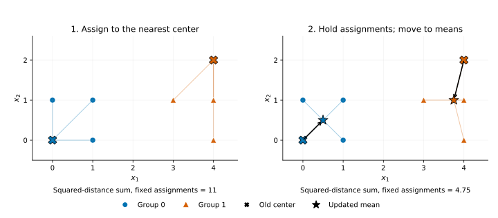

# KMeans

> Language: English
> Last updated: 2026-10-14
> Switch: [Chinese](../../cn/unsupervised/kmeans.md)

## Overview

Suppose you have temperature, pressure, and vibration measurements from machines, but no labels for their operating regimes. One overall average can hide several recurring patterns; separate thresholds on each measurement can miss combinations that distinguish those patterns. You want a small set of representative profiles and a way to assign each observation to one of them.

`KMeans` learns those profiles as cluster centers. It alternates between assigning each row to its nearest center and moving each center to the mean of its assigned rows. The result summarizes the data with a chosen number of prototypes. A center is an average profile, so it need not be an observation that actually occurred.

## When to use it

Use KMeans when distance to a representative center is a useful definition of similarity and you want a fixed number of roughly compact groups. Choose feature units deliberately: without rescaling, a measurement with a large numerical range can dominate squared distance. Standardization is one possible choice, but it also changes what counts as similar. The [K-means geometry guide](https://scikit-learn.org/stable/modules/clustering.html#k-means) explains why elongated or curved groups can be poorly represented by this objective.

The next choice depends on what you need from the grouping:

- [MiniBatchKMeans](minibatch-kmeans.md) keeps the same center-based goal while updating from smaller batches.
- [GaussianMixture](gaussian-mixture.md) is useful when overlapping groups call for model-based soft membership and covariance shapes.
- [DBSCAN](dbscan.md) addresses density-connected regions and can leave observations unassigned instead of forcing every row into a group.

KMeans will produce a partition even when the data do not contain distinct populations. Inspect the profiles, their usefulness for your task, and stability across seeds and reasonable preprocessing choices before giving the groups substantive names.

## Path

```python
from statgpu.unsupervised import KMeans
```

## Objective Function / Loss Function

Representing a row by its assigned center creates a reconstruction error. KMeans adds the squared errors over all rows and seeks centers and assignments that make this total, called inertia, small:

$$
\min_{C, z} \sum_{i=1}^{n} \left\|x_i - c_{z_i}\right\|_2^2 ,
$$

Here $x_i$ is row $i$, $n$ is the number of rows, $C$ is the collection of centers, and $c_{z_i}$ is the center assigned to that row. Squaring the distance gives large deviations more influence. For fixed assignments, the mean minimizes this sum within each cluster; for fixed centers, choosing the nearest center minimizes each row's contribution. These two observations lead to the alternating updates below.

<a id="estimating-equation"></a>
## Fitting steps and update formulas

The implementation uses Lloyd iterations:

- Initialize centers with `random` or greedy `k-means++`.
- Assign each sample to its nearest center using
  $$
  d_{ij}^2 = \left\|x_i\right\|_2^2 + \left\|c_j\right\|_2^2 - 2 x_i^\top c_j .
  $$
- Update each center to the mean of assigned samples.
  $$
  c_j = \frac{1}{|\{i: z_i = j\}|}\sum_{i:z_i=j} x_i .
  $$
- Reset empty clusters with the sample currently farthest from its assigned center.
- Stop when squared center movement is at most `tol`, or when `max_iter` is reached.
- Run `n_init` initializations and retain the solution with the lowest inertia.



The left panel assigns each point to the nearest of two chosen centers; the right panel holds those assignments fixed and moves each center to its group's mean. Arrows show the updates from `(0, 0)` and `(4, 2)` to `(0.5, 0.5)` and `(3.75, 1)`. The squared-distance sum falls from 11 to 4.75. This is a computed illustration of one Lloyd update, not an iteration history returned by `fit` or a claim of a global optimum.

## Parameters

- `n_clusters`: number of clusters.
- `init`: `"k-means++"` or `"random"`; callable init is not supported.
- `n_init`: `"auto"` uses `1` for k-means++ and `10` for random.
- `max_iter`, `tol`, `random_state`.
- `device`: `"auto"`, `"cpu"`, `"cuda"`, or `"torch"`.

## A small CPU example

<!-- learner-example: kmeans -->
```python
import numpy as np
from statgpu.unsupervised import KMeans

rng = np.random.default_rng(0)
X = np.vstack([rng.normal(-2, 0.3, (30, 2)), rng.normal(2, 0.3, (30, 2))])
model = KMeans(n_clusters=2, n_init=5, random_state=0, device="cpu")
labels = model.fit_predict(X)
print(labels.shape, model.cluster_centers_.shape, model.inertia_)
```

Labels have shape `(60,)` and centers `(2, 2)`. Label numbers are arbitrary. Inertia is a squared-distance sum, so compare it only on the same rows and units; lower inertia alone does not determine the right number of groups.

For a supported GPU installation, construct a new estimator with `device="cuda"` (CuPy) or `device="torch"` (Torch CUDA). Arrays generally stay on that backend; see the [API reference](api-reference.md#kmeans) for output ownership and host-side work. An unavailable explicit GPU raises an error.

## Approximation and interpretation

KMeans is an iterative non-convex optimizer and does not provide standard errors or significance tests. Different initializations can reach different local optima. Reproducibility depends on `random_state`, `init`, `n_init`, `max_iter`, and `tol`.

## Outputs

- `cluster_centers_`
- `labels_`
- `inertia_`
- `n_iter_`
- `n_features_in_`

## FAQ

**Why are labels different from sklearn although clusters match?**
Cluster IDs are arbitrary. Validation should use inertia, center matching, or permutation-invariant label metrics.

**Are sparse input and `sample_weight` supported?**
No. Dense KMeans raises for sparse input and `sample_weight`.


## Numerical and lifecycle cautions

Squared distances are evaluated through expanded norms. A large shared offset can cause cancellation, changing distances, inertia and potentially labels. Subtract a training-derived feature offset before fitting and use that same offset for prediction; this preserves Euclidean geometry. Centers can be reported in original units by adding the offset back.

## Complete API reference

Constructor defaults, all public methods, output shapes, and restrictions are listed in the [KMeans API reference](api-reference.md#kmeans).

## References

- MacQueen, J. (1967). Some methods for classification and analysis of multivariate observations. In *Proceedings of the Fifth Berkeley Symposium on Mathematical Statistics and Probability* (Vol. 1, pp. 281-297). University of California Press.
- Lloyd, S. P. (1982). Least squares quantization in PCM. *IEEE Transactions on Information Theory*, 28(2), 129-137. https://doi.org/10.1109/TIT.1982.1056489
- Arthur, D., & Vassilvitskii, S. (2007). k-means++: The advantages of careful seeding. In *Proceedings of the Eighteenth Annual ACM-SIAM Symposium on Discrete Algorithms (SODA 2007)* (pp. 1027-1035). Society for Industrial and Applied Mathematics.
