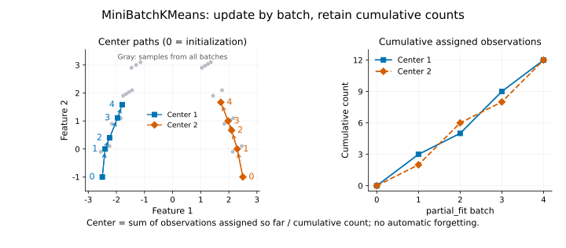

# MiniBatchKMeans

> Language: English
> Last updated: 2026-10-14
> Switch: [Chinese](../../cn/unsupervised/minibatch-kmeans.md)
> Path: `statgpu.unsupervised.MiniBatchKMeans`

## Overview

You may want a few representative profiles for millions of observations, or need to update those profiles as records arrive in chunks. Full KMeans revisits every row when updating its centers. Fitting once to a small subset avoids that work but leaves later observations out of the learned profiles.

`MiniBatchKMeans` lets successive batches contribute to the same centers. Each batch is assigned using the current centers, then its cluster-wise averages are combined with the accumulated assignments. It changes how the centers are learned, not what a good center means: the target is still squared Euclidean reconstruction error. The [mini-batch algorithm description](https://scikit-learn.org/stable/modules/generated/sklearn.cluster.MiniBatchKMeans.html) provides the broader algorithmic context; the full-data steps used by statgpu are described below.

## When to use it

Use it when smaller, incremental center updates fit your workflow and an approximate solution is acceptable. Ordinary [KMeans](kmeans.md) remains a useful comparison when full-data iterations are affordable. Mini-batching does not solve KMeans' geometric limitations or introduce noise labels or membership probabilities.

There are two distinct workflows in statgpu. `fit` still takes the whole dense dataset and performs final full-data polishing, so selecting a small batch size does not make that call an out-of-core fit. For an external stream, feed chunks through `partial_fit`. Keep the same feature meanings, scaling, and centering across chunks; with data-based initialization, the first chunk must contain enough rows to initialize all centers.

Batch composition matters. A first batch containing only one operating regime is a poor starting view of the whole population. Where possible, mix or shuffle representative records and check final centers on a common evaluation set. The cumulative updates also retain old observations' influence: there is no forgetting mechanism, so this is not automatically a model of only the most recent behavior.

## Path

Import from `statgpu.unsupervised`:

```python
from statgpu.unsupervised import MiniBatchKMeans
```

## Objective Function / Loss Function

The target is the same inertia as KMeans:

$$
\sum_i \min_j \|x_i - c_j\|_2^2.
$$

Each $x_i$ is an observation and $c_j$ a center; the minimum chooses the closest center for that row. Mini-batch updates optimize this objective approximately, using each batch's assignments rather than recomputing all earlier assignments after every update.

## Estimating Equation

For a batch-assigned cluster `j`, statgpu updates its center with cumulative counts:

$$
c_j \leftarrow c_j + \eta_j(\bar{x}_{B_j} - c_j),
\qquad
\eta_j = \frac{|B_j|}{n_j + |B_j|}.
$$

Here $B_j$ contains this batch's rows assigned to center $j$, $\bar{x}_{B_j}$ is their mean, and $n_j$ is the accumulated assignment count before the batch. Thus $\eta_j$ is the new batch's share of the combined count. As that accumulated count grows, an equally sized new batch moves the center less; a cluster receiving no rows keeps its center.

After mini-batch updates, `fit` runs a small exact Lloyd polishing pass on the full dense dataset. This keeps the estimator mini-batch driven while reducing the final inertia gap against full-data label assignments.



The left panel records two centers after four actual `partial_fit` calls; step 0 marks their supplied initial positions. Gray points show the observations from all four batches, not a final labeling. The right panel records `counts_`, the accumulated assignments to each center. Earlier batches retain their influence, so the centers do not simply follow the latest batch means. This illustrates `partial_fit`; `fit` additionally performs the full-data polishing described above, and these paths are not a speed comparison.

## Parameters

`n_clusters`, `init`, `n_init`, `batch_size`, `max_iter`, `max_no_improvement`, `tol`, `random_state`, and `device`.

## A small CPU example

<!-- learner-example: minibatch-kmeans -->
```python
import numpy as np
from statgpu.unsupervised import MiniBatchKMeans

rng = np.random.default_rng(0)
X = np.vstack([rng.normal(-2, 0.3, (30, 2)), rng.normal(2, 0.3, (30, 2))])
rng.shuffle(X)
model = MiniBatchKMeans(n_clusters=2, random_state=0, device="cpu")
for start in range(0, len(X), 15):
    model.partial_fit(X[start:start + 15])
labels = model.predict(X)
print(labels.shape, model.labels_.shape, model.n_steps_)
```

The requested all-data labels have shape `(60,)`, while `labels_` only covers the last batch `(15,)`. That stored batch labeling predates its center update; `predict` uses current centers. `counts_` accumulates assignments after `partial_fit`.

For a supported GPU installation, construct a new estimator with `device="cuda"` (CuPy) or `device="torch"` (Torch CUDA). Arrays generally stay on that backend; see the [API reference](api-reference.md#minibatchkmeans) for output ownership and host-side work. An unavailable explicit GPU raises an error.

## Approximation and interpretation

The method is stochastic and approximate. Fair comparisons should use the same initial centers, batch order, tolerance, and iteration budget.

## Outputs

`cluster_centers_`, `labels_`, `inertia_`, `n_iter_`, `n_steps_`, `counts_`, and `n_features_in_`.

## FAQ

The current implementation supports dense Euclidean data only. Sparse input, sample weights, and callable initialization are not supported.


## Numerical and lifecycle cautions

Explicit initial centers must be finite. The current implementation checks their shape but does not reliably reject NaN or infinity: `partial_fit` can return non-finite centers and inertia. For NumPy initial centers, check `np.isfinite(initial_centers).all()` before construction; reject or correct invalid values before fitting. Ordinary `fit` may hide the invalid initialization through its final polishing steps, so a finite result is not a substitute for this input check.

Squared distances are evaluated through expanded norms. A large shared offset can cause cancellation, changing distances, inertia and potentially labels. Subtract a training-derived feature offset before fitting and use that same offset for prediction; this preserves Euclidean geometry. Centers can be reported in original units by adding the offset back.

## Complete API reference

Constructor defaults, all public methods, output shapes, and restrictions are listed in the [MiniBatchKMeans API reference](api-reference.md#minibatchkmeans).

## References

- Sculley, D. (2010). Web-scale k-means clustering. *Proceedings of the 19th International Conference on World Wide Web*, 1177-1178.
- scikit-learn developers. `sklearn.cluster.MiniBatchKMeans` API documentation.
